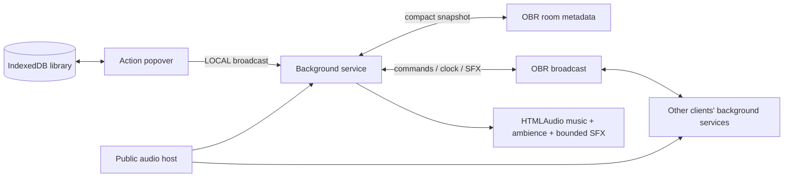

# สถาปัตยกรรม Resonance

## ขอบเขต

เป็น Owlbear Rodeo extension แบบเว็บ static ใช้ React, TypeScript, Vite และ `@owlbear-rodeo/sdk@3.1.0` ไม่มี backend สำหรับส่งเสียง ไฟล์เสียงไปจากผู้ให้บริการ URL ถึง browser ของผู้ฟังแต่ละคนโดยตรง



## การแยก lifecycle

`index.html` ใช้เป็น action UI ส่วน `background.html` เป็นเจ้าของ RoomService และ AudioEngine เพียงชุดเดียวต่อ connection การเปิด/ปิด popover ไม่สร้าง audio engine เพิ่ม และการเปิดหน้าเว็บนอก Owlbear จะเข้า standalone simulator ที่มีป้าย Local Preview

UI รับสถานะอุปกรณ์ด้วย LOCAL broadcast จึงไม่เขียนระดับเสียงส่วนตัวลงห้อง ไม่ส่งคลังเพลงหรือ favorites ไปยังผู้เล่นอื่น

## สถานะที่แชร์

ใช้ key `app.resonance/transport` รูปแบบ version 1:

```ts
{
  epoch, revision, controller, controllerName, updatedAt, fade,
  music: { track, playing, position, anchor, gain, loop },
  ambience: { track, playing, position, anchor, gain, loop },
  queue: TrackRef[]
}
```

TrackRef มีเพียง id, title และ URL ไม่ส่งแท็กหรือข้อมูลเสียง จำกัด snapshot ของโครงการที่ 12,000 bytes และ queue 20 รายการ เพราะ room metadata ของ SDK รวมทั้งห้องต้องน้อยกว่า 16KB หากส่วนขยายอื่นใช้พื้นที่จนเต็ม SDK อาจปฏิเสธ write ได้ และ UI จะแสดง error

เขียน metadata เมื่อมีคำสั่งเปลี่ยน state เท่านั้น ไม่ส่ง progress เป็น heartbeat ปุ่มลาก seek / room gain ใน UI จะรวมค่าล่าสุดด้วย debounce 120ms เพื่อไม่สะสมคำสั่งทุก pointer event การแก้สถานะใน service ถูกเรียงลำดับด้วย promise chain ที่ฟื้นจาก error ของคำสั่งก่อนหน้าได้

Broadcast ใช้สำหรับ command, snapshot ที่ช่วยให้ตอบสนองไว, clock probe และ one-shot effects snapshot ผ่าน broadcast ต้องมาจาก connection ของ conductor และเป็น epoch ปัจจุบัน ตัว metadata ยังคงเป็นสถานะถาวรสำหรับ late join

## เวลาและ drift

ตำแหน่งเป้าหมายเป็น `position + (conductorNow - anchor) / 1000` เฉพาะเมื่อ playing; เพลงวนใช้ modulo duration

ผู้ฟัง probe เวลา conductor ทุก 5 วินาทีด้วย NTP-style four timestamps เก็บ sample ล่าสุดไม่เกิน 8 ตัว/30 วินาที แล้วใช้ตัวที่ RTT ต่ำที่สุดในช่วงนั้น ค่าเก่าหมดอายุได้ จึงตามการปรับนาฬิกาของระบบได้ Reject sample ที่เวลา/RTT ผิดลำดับ

ตรวจ drift ทุก 2 วินาที ใช้ระยะสั้นที่สุดเมื่อข้ามขอบ loop หากคลาดเกิน 0.8 วินาทีจะ seek; หากเกิน 0.12 วินาทีจะปรับ playbackRate ในช่วง 0.97–1.03 เมื่อ focus กลับมาจะ align อีกครั้ง การเปลี่ยน gain อย่างเดียวไม่ hard-seek เพลงซ้ำ

การ Take control reanchor ทั้งสอง bus ด้วยตำแหน่งที่คำนวณได้ แล้วสร้าง epoch ใหม่บน clock ของ GM คนใหม่ หากไม่มี sample จาก conductor เดิมจะใช้ local clock เป็นค่าประมาณ เหตุการณ์หลาย GM takeover พร้อมกันยังอาศัย last metadata write ของ SDK

## Audio ownership

- sustained bus แต่ละชั้นใช้หนึ่ง deck ปกติ และมี outgoing เพิ่มหนึ่ง deck ระหว่าง fade เท่านั้น
- incoming เริ่ม fade หลัง `play()` สำเร็จ ใช้ elapsed monotonic time กับ timer; ไม่ผูกการเล่นเสียงไว้กับ requestAnimationFrame ที่อาจหยุดใน background tab
- Pause/stop/เปลี่ยนเพลง/error/destroy ยกเลิก fade และคืน outgoing URL/load handler
- one-shot สี่เสียงพร้อมกันสูงสุด มี event ID dedup, ตรวจอายุ event 5 วินาที, ล้าง history หลัง 60 วินาที และหยุดเสียงที่เกิน 120 วินาที
- `Stop all` หยุดทั้ง sustained buses, queue และ one-shots
- URL ที่ยังไม่ active ไม่ถูก preload; ไม่ fetch/decode เพลงทั้งคลังเข้า RAM
- ไม่ตั้ง `crossOrigin=anonymous` หรือใช้ MediaElementAudioSourceNode โดยปริยาย เพื่อให้เล่น public hosts ที่ไม่ได้เปิด Web Audio CORS ได้
- รองรับสถานะ loading, paused, playing, blocked, error และ timeout; ไม่ retry URL เสียแบบวนไม่สิ้นสุด
- หาก nonloop timeline จบไปก่อนโหลด/รับช่วง control แล้ว engine ส่ง completion ครั้งเดียวต่อ timeline ให้ conductor ข้ามไปเพลงถัดไปได้

## คลังเพลงและ import

IndexedDB v1 แยก tracks, cues และ settings ทำให้ไม่ serialize คลังทั้งหมดลง localStorage ทุกครั้ง ก่อน import ต้อง validate ทั้งไฟล์ สำเร็จแล้วค่อยเขียนใน transaction ใช้ Map จับคู่ normalized URL และจัดการ ID collision ไม่ให้เพลงคนละ URL ทับกัน

CSV รองรับ quoted fields, newline, BOM และ tags คั่น `|`; export escape spreadsheet formula prefix JSON backup version 1 เก็บชนิดเสียง favorites และ scene ด้วย URL ถูกจำกัด HTTPS หรือ HTTP loopback สำหรับ development; ปฏิเสธ credentials, file/javascript URL และบริการหน้าเว็บที่ไม่ใช่ direct audio

ถ้าเปิด IndexedDB ไม่ได้ ใช้ memory library ที่ export ได้ พร้อมคำเตือนว่าข้อมูลจะหายเมื่อปิดหน้า หาก quota เต็มหลังเปิด DB แล้วจะแจ้ง write error โดยไม่ล้างข้อมูลเดิม

## การตรวจสิทธิ์

ตรวจ role จาก SDK และจับคู่ **event.connectionId** กับรายชื่อ party และ self ไม่เชื่อ `role` ใน payload คำสั่งที่มาจากผู้เล่นถูกละทิ้ง ส่วน personal gain/mute/unlock/status รับผ่าน LOCAL ของ connection ตัวเอง

นี่เป็นนโยบายของ extension SDK ไม่ได้ให้ server ACL เฉพาะ metadata key นี้ Client ที่ดัดแปลงโค้ดอาจเขียน namespace ผ่าน API เองได้ จึงไม่ควรอ้างว่าเป็นระบบป้องกัน client ฝั่งผู้เล่นที่เป็นอันตรายแบบสมบูรณ์

## หลักฐานการทดสอบ

30 unit tests ครอบคลุม timeline, drift, NTP sample, input validation, CSV/JSON, URL merge/ID collision, storage fallback, autoplay failure/retry, deck cleanup, one-shot bound, nonloop completion, GM check, serialized writes, stale revision, takeover และอายุ clock sample

2 browser scenarios ใช้ Chrome จริงและ actual SDK ผ่าน test host ครอบคลุม flow คลัง/scene/queue/import/backup, mobile overflow 320/375/480px, GM กับ late-joining listener, role spoof rejection, personal volume isolation, การถอดและสร้าง action iframe ใหม่ และ crossfade ที่ปล่อย outgoing source หลัง panel ปิด

ยังไม่ได้ทดสอบห้อง Owlbear บน backend จริง, Safari/Firefox/iOS, network loss ยาวนาน, background suspend บนทุก OS หรือ codec ทุกชนิด ต้องทำ acceptance เหล่านี้ก่อนอ้างความพร้อมใช้งาน production ครบทุกแพลตฟอร์ม

อ้างอิง SDK: [Manifest](https://docs.owlbear.rodeo/extensions/reference/manifest/), [Room](https://docs.owlbear.rodeo/extensions/apis/room/), [Broadcast](https://docs.owlbear.rodeo/extensions/apis/broadcast/), [Metadata](https://docs.owlbear.rodeo/extensions/reference/metadata/), [Autoplay](https://developer.mozilla.org/en-US/docs/Web/Media/Guides/Autoplay), [Web Audio CORS](https://webaudio.github.io/web-audio-api/#MediaElementAudioSourceNode-security)
