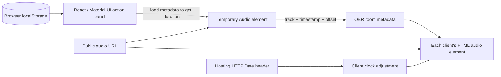

# ผลตรวจ Tracks 1.8.0 ด้วย REA

ตรวจเมื่อ **8 พฤศจิกายน 2026 ตามเวลา Asia/Bangkok** เป้าหมายคือ [Tracks ใน Owlbear Extension Store](https://extensions.owlbear.rodeo/tracks) โดย Jordan Cohen และไฟล์ที่เผยแพร่จาก `https://obr-tracks.web.app/`

ผลนี้แยก **สิ่งที่พบใน artifact**, **สิ่งที่รันพบในห้องจำลอง**, **ข้อสรุปเชิงออกแบบ** และ **สิ่งที่ยังไม่ได้ยืนยัน** ไม่ได้อ้างว่าได้ source ต้นฉบับครบ หรือทดสอบบัญชี/ห้องจริงของผู้ใช้

## ตัวที่ตรวจและหลักฐาน

- Manifest ที่ดาวน์โหลดระบุชื่อ Tracks, version **1.8.0**, manifest_version 1, action popover `/` กว้าง 400px และไม่มี background_url ใน manifest ที่ตรวจ
- HTML อ้าง JavaScript `/assets/index-82c44e3a.js` เพียง bundle หลักหนึ่งรายการ
- Bundle ขนาด **667,713 bytes**; SHA-256 `0b4b7ef3154152314cfe94b749194eea39df12bbd353d043490ae17adc14e41e`
- สำเนาไฟล์และหลักฐานอยู่ที่โฟลเดอร์ข้างโปรเจกต์ `../tracks-investigation/`

| Evidence ID                                                           | ขอบเขตและผล                                                                                                                                                                                           |
| --------------------------------------------------------------------- | ----------------------------------------------------------------------------------------------------------------------------------------------------------------------------------------------------- |
| `ev_6bd9da4b6708203b21ef08b6582fcc8e6de08fb74455c711c7c68ab7afe9d1e5` | ตรวจ artifact ทั้ง directory; worker ใช้ heap 1GiB จนหมดก่อนวิเคราะห์ JavaScript สำเร็จ จึงไม่ใช่หลักฐาน graph ครบ                                                                                    |
| `ev_b341af852c09d7369de31ce1b9c184b378de2116dbdb777e33290b31eb199a26` | วิเคราะห์ส่วนท้าย application 107,067 bytes; parse syntax ได้ แต่ semantic retention ชนเพดาน 20,000 nodes และยังมี unknowns                                                                           |
| `ev_912bdda9fd87ff45043c6030ef0813f9d353fb36652bc8e97507721831597e35` | วิเคราะห์ core 37 top-level statements รวม 4,725 bytes ที่คัดจาก AST ด้วยตำแหน่ง exact spans; syntax complete ในขอบเขตนี้ ไม่ใช่ครบทั้ง dependency และยังมี conservative semantic unknowns 367 รายการ |
| `ev_35b699dc603637bb7cfa2f6935f36e71ce468ddbce0917ec59fc980d47e1d6ac` | REA controlled browser replay: รอรายการเพลง → play → unmute → pause → resume ทุกขั้น completed และ provider ปิด browser ที่เป็นเจ้าของแล้ว                                                            |

ไฟล์ `core/provenance.json` บันทึกชื่อ statement, UTF-16/UTF-8 start/end และ hash ของ bundle ต้นทาง การคัดใช้ข้อความเดิมจาก artifact ไม่ได้ de-minify แล้วอ้างว่าเป็น original source การรันจริงใช้ bundle เดิมทั้งก้อน ไม่ได้รันเฉพาะ snippet

มี replay รอบแรกที่ fixture ส่ง theme ไม่ครบรูปแบบ ทำให้ MUI error; แก้ fixture ตาม SDK Theme แล้วจึงได้ final replay ข้างต้น Error แรกนั้นไม่ถูกนับเป็นบั๊กของ Tracks ผลเก่าถูกเก็บอยู่ใน full evidence bundle เพื่อไม่ลบประวัติการตรวจ

## Tracks ทำงานอย่างไร



**UI และ SDK — artifact observation.** Bundle มี React, Material UI และ Owlbear SDK message bus ใช้ `postMessage` สื่อสารกับ host ของ Owlbear UI เปิดเป็น action popover ตาม manifest โค้ดส่วนท้ายมี virtual-list implementation ด้วย จึงไม่สรุปว่า Tracks วาดเพลงทั้งคลังลง DOM ทุกครั้ง

**คลังเพลง — artifact observation.** เก็บ array ใน localStorage ที่ key `com.obr.tracks/library` รายการมี `title`, `url`, `tags` การอ่านใช้ JSON.parse และการแก้ไขเขียน array กลับ การแจ้ง UI ภายในใช้ EventEmitter มีการ merge import โดย URL; implementation ที่ตรวจวนรายการนำเข้าเทียบคลังเดิมทีละรายการ จึงมีต้นทุน O(import × library) สำหรับส่วนจับคู่

**ค้นหาและ CSV — documentation + artifact observation.** หน้า store ระบุค้นหาชื่อ/แท็กแบบ fuzzy และ import/export CSV คอลัมน์ `title,url,tags` โดย tags คั่นด้วย `|`; URL ตรงกันให้อัปเดตรายการเดิม เอกสารระบุว่าแก้ title/tags ได้แต่แก้ URL ต้องลบแล้วเพิ่มใหม่ ซึ่งสอดคล้องกับฟอร์มที่ bundle ตั้ง disabled ให้ช่อง URL เมื่อเป็น edit [เอกสาร Tracks](https://extensions.owlbear.rodeo/tracks)

**เริ่มเล่น — artifact observation และ corroborated replay.** ฟังก์ชัน `j6` สร้าง Audio ชั่วคราว, preload metadata และรอ duration ก่อนเขียน `com.obr.tracks/control` ลง room metadata ตัวผู้ฟัง subscribe metadata แล้วอัปเดต `<audio id="tracks-audio-player">` ของเครื่องตนเองจาก URL เดียวกัน โค้ดตั้ง loop=true จึงเหมาะกับเพลง/ambience ที่เล่นต่อเนื่อง

รูปแบบ control ที่พบ:

```ts
{ id, time, action, offset, duration, track: { title, url, tags } }
// action: 0 = Play, 1 = Pause
```

**ตำแหน่งเสียง — artifact observation.** ตอน playing ใช้ `(offset + elapsedSinceMessage) % duration` ตอน pause เก็บ offset และตอน resume ใช้ offset เดิมกับ timestamp ใหม่ การ sync จึงเป็นการให้ browser แต่ละเครื่องเล่นไฟล์เดียวกันตาม timeline ไม่ใช่ส่ง stream เสียงจาก GM ไปให้ผู้เล่น

**นาฬิกา — artifact observation + replay.** `GF` fetch hosting origin แบบ no-store แล้วอ่าน HTTP `Date` header มาปรับ skew ของเครื่อง ตอนรับ message ที่เหมือนมาจากอนาคตจะปรับเวลา message เป็นเวลาปัจจุบัน ในส่วน core ที่ตรวจไม่มี RTT-based clock exchange หรือ periodic continuous drift correction แบบที่เพิ่มใน Resonance

**Dropbox — artifact observation.** ตรวจ hostname ที่ลงท้ายด้วย `dropbox.com`, เปลี่ยนเป็น `dl.dropboxusercontent.com` และตั้ง query dl=1 ส่วน Resonance ใช้ allowlist exact hostname และ normalize URL ก่อนใช้/merge

**Analytics — artifact observation + replay.** มี Firebase Analytics initialization และ event calls ใน application core; network replay พบ Firebase configuration/installations, Google Tag Manager และ Google Analytics requests สิ่งนี้ไม่ได้ยืนยันว่ามี audio relay บน Firebase ในขอบเขตการเล่นที่ตรวจ ไฟล์เสียงถูกโหลดจาก public URL โดย browser โดยตรง

## สิ่งที่ REA รันยืนยันได้

รัน original bundle ที่ดาวน์โหลดไว้ใน **controlled SDK host บน loopback** โดยให้ test WAV ต้นฉบับที่สร้างใหม่ เพื่อไม่พึ่งไฟล์เสียงของบุคคลอื่น Host จำลอง OBR_READY, room metadata, role, theme และ API response แต่ใช้ JavaScript ของ Tracks จริงโดยไม่แก้ bundle

- คลิกเพลงทำให้มี media GET ไปยัง `/audio/test.wav`
- เกิด control action 0, offset 0, duration 16
- กด pause แล้วเกิด action 1, offset **0.948** วินาที
- กด resume แล้วเกิด action 0 โดยเก็บ offset **0.948** ไว้
- Console ของ original bundle แสดงการอ่าน server Date และ skew ตามที่เห็นใน source
- ตรวจ DOM/Audio ผ่าน browser corroboration พบ audio element loop=true, เริ่ม muted=true และเล่นตามเวลาได้


`runtime-observations.json` เป็นผลสรุปเล็กที่อ่านได้ง่าย ส่วน `rea-evidence.json` เป็น evidence bundle แบบเต็มประมาณ 39MB รวมทั้งผลที่มีข้อจำกัด ไม่มีการอ้างว่า replay นี้เท่ากับทดสอบ backend ของ Owlbear จริง Network บางรายการยังไม่จบเมื่อสิ้นสุด capture; favicon/icon บางรายการตอบ 404 จาก fixture ไม่ใช่ข้อบกพร่องที่ยืนยันของ deployment ต้นฉบับ

## สิ่งที่นำมาปรับปรุงใน Resonance

| ประเด็น          | Tracks ที่ตรวจ                                                         | Resonance ที่สร้าง                                                                         |
| ---------------- | ---------------------------------------------------------------------- | ------------------------------------------------------------------------------------------ |
| หลักการส่งเสียง  | public URL + shared timeline                                           | คงหลักการเดียวกัน จึงไม่ต้องมี media relay                                                 |
| Audio lifecycle  | audio อยู่ในต้นไม้ UI ของ action ที่ตรวจ; ผลปิด panel จริงยังไม่ยืนยัน | background audio service แยกจาก action และทดสอบถอด action iframe แล้ว                      |
| ชั้นเสียง        | control หลักหนึ่งเพลง, loop=true                                       | music + ambience, one-shots สูงสุด 4 เสียง                                                 |
| การเปลี่ยนเพลง   | โหลด metadata แล้วเปลี่ยน source                                       | crossfade 0–10s, ควบคุม outgoing deck และ cleanup                                          |
| ซิงก์เวลา        | Date header ปรับ skew, message time + offset                           | recent NTP-style probes, late join, periodic drift correction, explicit conductor takeover |
| Library          | localStorage array                                                     | IndexedDB แยก records, memory fallback เมื่อ storage ถูกบล็อก                              |
| Import           | URL matching แบบ nested scan ใน core ที่ตรวจ                           | validate ก่อนเขียน, Map merge, transaction, ป้องกัน ID collision                           |
| บันทึกข้อมูล     | Tracks CSV                                                             | CSV compatible + JSON แบบมี version เก็บ scene/favorites/kind                              |
| Workflow         | เพิ่ม/ค้นหา/แก้ชื่อและแท็ก/ลบ/เล่นวน                                   | เพิ่ม queue, scenes, soundboard, favorites, editable URL และ shortcuts                     |
| Failure handling | core บางส่วน throw error และ validator ตรวจ field presence             | structured input validation, UI loading/blocked/error/retry และ resource caps              |

ตารางเป็นการเทียบขอบเขตที่มีหลักฐาน ไม่ได้ยืนยันว่า Tracks ไม่มีฟีเจอร์อื่นในเวอร์ชัน/branch ที่ไม่ได้ตรวจ

## ประสิทธิภาพที่วัดได้และขอบเขต

ดูค่าปัจจุบันใน [measurements.json](measurements.json) และรันซ้ำด้วย `npm run measure` หลัง build

- JavaScript หลักเดิมที่โหลดมา: 667,713 bytes; gzip ด้วย Node zlib ชุดเดียวกัน 199,979 bytes
- JavaScript ของ build ใหม่รวม app + service + background อยู่ประมาณ **395KB**, gzip ประมาณ **120KB** ลดขนาด JavaScript ราว **40%** ในวิธีนับนี้
- ตัวเลขไม่รวม CSS, fonts, demo audio หรือ remote dependencies และไม่ใช่ขนาด HTTP transfer ที่วัดจาก CDN
- synthetic library 10,000 รายการใช้ทดสอบการสร้าง Fuse index/ค้นหาใน Node เท่านั้น เวลาแต่ละ run อยู่ใน JSON ไม่ได้อ้างว่าเร็วกว่าต้นฉบับบน browser ทุกเครื่อง
- การใช้ Map merge, เขียน metadata เฉพาะ state change, รวม slider updates และไม่ preload ทั้งคลังเป็นการปรับปรุงเชิงออกแบบ ไม่มีผล benchmark เทียบ CPU/RAM/latency กับต้นฉบับเพื่ออ้างเปอร์เซ็นต์ความเร็ว

## สรุปสถานะคำถามที่ตรวจ

| คำถาม                                                  | สถานะ                                                                  |
| ------------------------------------------------------ | ---------------------------------------------------------------------- |
| เป้าหมายและเวอร์ชันไหน                                 | ตอบได้จาก manifest และ hash                                            |
| UI/คลัง/CSV/ส่วนเล่นเสียงใช้ระบบอะไร                   | ตอบได้ในขอบเขต artifact ที่ตรวจและเอกสาร                               |
| เล่น/พัก/เล่นต่อส่งสถานะอย่างไร                        | ตอบได้ทั้ง source และ controlled replay                                |
| ระบบจริงกับหลาย browser/host ที่ต่างกันทำงานครบหรือไม่ | ยังไม่ยืนยัน ต้องทดสอบห้องจริงและ cross-browser                        |
| สร้างโปรเจกต์รูปแบบเดียวกันที่เพิ่มฟีเจอร์             | สร้าง source + static build แล้ว มีรายงาน architecture และผล tests     |
| เร็วขึ้นทุกมิติหรือไม่                                 | ยังไม่อ้าง วัดเฉพาะ bundle size และ synthetic search smoke measurement |

แหล่งข้อมูลหลัก: [Tracks official listing](https://extensions.owlbear.rodeo/tracks), [OBR SDK manifest](https://docs.owlbear.rodeo/extensions/reference/manifest/), [Room metadata](https://docs.owlbear.rodeo/extensions/apis/room/), [Broadcast](https://docs.owlbear.rodeo/extensions/apis/broadcast/), original shipped artifact และ REA Evidence IDs ข้างต้น
